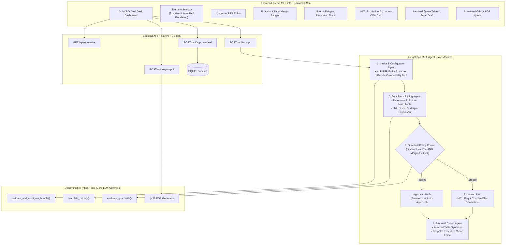

# QuikCPQ — Autonomous Deal Desk Agent
### Next-Gen Agentic Configure-Price-Quote (CPQ) with Deterministic Financial Guardrails

[](https://fastapi.tiangolo.com)
[](https://github.com/langchain-ai/langgraph)
[](https://ai.google.dev)
[](https://vitejs.dev)
[](https://tailwindcss.com)
[](https://sqlite.org)

---

## Executive Summary & Problem Statement

In enterprise B2B SaaS sales, the **Deal Desk** is often the primary bottleneck between closing a contract and losing a customer. Sales representatives frequently spend **3 to 5 business days** passing pricing spreadsheets between finance, solutions engineering, and sales operations to:
1. **Validate complex bundle prerequisites** (e.g., verifying whether Enterprise SSO can be provisioned on a Starter tier).
2. **Calculate seat volume discounts** and assess the cost of goods sold (COGS).
3. **Prevent gross margin erosion** caused by over-discounting to win quotas.
4. **Acquire VP of Finance approvals** for non-standard payment or discount terms.

Human calculation errors in spreadsheets cause **margin leaks**, unapproved discount creep, and broken SLA commitments.

**QuikCPQ** solves this with an **autonomous, agentic Deal Desk system** built on **LangGraph** and **Google Gemini**, fortified with **strictly deterministic Python math tools** and **Human-in-the-Loop (HITL) executive controls**. QuikCPQ reduces quote turnaround time from **72 hours to under 2 seconds** while guaranteeing 100% adherence to financial policies.

---

## Key Features & Innovations

- **LangGraph Multi-Agent Architecture:** A coordinated pipeline of 4 specialized agents:
  1. **Intake & Configurator Agent:** Parses unstructured customer RFPs and validates catalog compatibility matrices.
  2. **Deal Desk Pricing Agent:** Executes deterministic Python math tools—**never hallucinated LLM arithmetic**—for list prices, volume discounts, COGS (60%), and net gross margin.
  3. **Guardrail Policy Router:** Conditional routing edge that verifies max discount ceilings (<= 15%) and minimum gross margin floors (>= 25%).
  4. **Proposal Closer Agent:** Generates itemized schedules, contractual terms, and tailored executive response emails.
- **Self-Healing Product Bundles:** When a customer requests an incompatible combination (e.g. *Enterprise SSO* on a *Starter* tier), the Configurator Agent automatically upgrades the base tier to *Pro*, documents the technical rationale, and prices the correct configuration.
- **Autonomous Compliant Counter-Offers (HITL):** When a customer demands an excessive discount (e.g. 35%), the system blocks autonomous approval (`ESCALATED`), calculates the financial breach (7.7% gross margin vs. 25% floor), and algorithmically formulates an authorized counter-offer (15% discount + 24-month commitment) that restores margins while meeting procurement timelines.
- **Managerial Override Workflow:** Complete Human-in-the-Loop interface allowing Deal Desk Managers to review audit flags, grant executive exceptions, or accept compliant counter-offers with a single click.
- **Enterprise PDF Quote Generator:** Generates professional, publication-grade B2B SaaS proposal documents via `fpdf2` with customer information, itemized line items, compliance seals, and signature acceptance blocks.
- **Zero-Friction Dual Mode:** Evaluators can run the app immediately in **Demo Simulator Mode** (no external API keys required) or toggle to **Live Gemini Agent Mode** powered by `google-genai` and `gemini-2.5-flash`.
- **Full Audit Trail Persistence:** All quotes, rule checks, and manager overrides are recorded in a local SQLite audit database (`backend/data/audit.db`).

---

## Architecture Diagram



---

## Product Catalog & Governance Matrix

All business logic and financial parameters are configured in `backend/data/catalog.json`:

### 1. Base Subscription Tiers
| Tier ID | Display Name | Unit Price | Description |
|:---|:---|:---|:---|
| `starter` | Starter | **$50.00** / seat / mo | Essential CPQ workflow for fast-growing sales teams |
| `pro` | Pro | **$120.00** / seat / mo | Workflow automation, dynamic discounting, CRM sync |
| `enterprise` | Enterprise | **$250.00** / seat / mo | Dedicated tenant, SOC2 Type II, custom AI modules |

### 2. Add-on Modules & Dependencies
| Add-on ID | Name | Price | Unit | Dependency Prerequisite |
|:---|:---|:---|:---|:---|
| `enterprise_sso` | Enterprise SSO | $30.00 | / seat / mo | **Requires Pro or Enterprise tier** |
| `dedicated_support` | Dedicated Support | $1,500.00 | / flat / mo | Valid on any tier (24/7 TAM SLA) |
| `custom_ai_module` | Custom AI Module | $80.00 | / seat / mo | **Requires Enterprise tier only** |

### 3. Volume Discount Rules
| Seat Range | Volume Discount % |
|:---|:---|
| **1 - 49 Seats** | 0.0% |
| **50 - 199 Seats** | 10.0% |
| **200+ Seats** | 15.0% |

### 4. Autonomous Financial Guardrails
- **Base COGS Ratio:** Strictly calculated at **60.0% of List Price**.
- **Minimum Gross Margin Floor:** **25.0%**. Any configuration yielding a gross margin below 25.0% is blocked from autonomous approval and routed to HITL.
- **Max Auto-Approved Discount Ceiling:** **15.0%**. Any requested discount exceeding 15.0% triggers an escalation.

---

## Pre-Loaded Benchmark Scenarios

The system includes three realistic customer RFP scenarios (`backend/data/sample_rfps.json`):

### Scenario 1: Standard Deal (Auto-Approved)
- **Customer:** Acme Logistics Inc. (Sarah Jenkins, VP Operations)
- **Request:** 60 seats of `Pro` tier + `Dedicated Support`.
- **Agent Behavior:**
  - Configurator validates bundle compatibility.
  - Pricing agent calculates 60 seats × $120 ($7,200) + $1,500 Dedicated Support = $8,700/mo list price.
  - Automatically applies 10% Tier 1 volume discount -> $7,830.00/mo ($93,960/yr).
  - COGS = $5,220/mo. Gross margin = **33.33%** (well above 25% floor).
  - Guardrail Router sets status to `APPROVED`.

### Scenario 2: Invalid Bundle (Auto-Fix Dependency)
- **Customer:** FinServe Corp (Marcus Vance, Head of Enterprise Infrastructure)
- **Request:** 40 seats of `Starter` tier + `Enterprise SSO`.
- **Agent Behavior:**
  - Configurator detects architectural incompatibility: *Enterprise SSO requires Pro or Enterprise base tier*.
  - **Auto-Fix Applied:** Automatically promotes base tier from `Starter` ($50) to `Pro` ($120), updates line items, and documents technical rationale in the trace.
  - Prices 40 seats × $120 ($4,800) + 40 × $30 ($1,200) = $6,000/mo.
  - Auto-approved without requiring manual sales intervention.

### Scenario 3: Margin Guardrail Escalation (HITL & Counter-Offer)
- **Customer:** GlobalTech Solutions (Elena Rostova, Chief Procurement Officer)
- **Request:** 150 seats of `Enterprise` ($250) + `Custom AI Module` ($80) with an aggressive **35% discount**.
- **Agent Behavior:**
  - List price = 150 × ($250 + $80) = $49,500/mo ($594,000/yr).
  - Requested 35% discount drops net price to $32,175/mo. COGS is $29,700/mo.
  - Projected gross margin plummets to **7.69%**, severely violating the 25% policy floor.
  - Guardrail Router halts autonomous execution and flags deal as `ESCALATED`.
  - **Autonomous Counter-Offer:** Agent synthesizes a pre-approved compliant offer: **15% discount** ($42,075.00/mo), locking a healthy **29.41% gross margin** in exchange for a **24-month contract term commitment**.
  - Manager can click **"Accept Compliant Counter-Offer"** or **"Approve Manager Override"** to finalize the deal.

---

## Getting Started & Local Setup

### Prerequisites
- **Python 3.11+**
- **Node.js 18+ & npm**
- *(Optional)* **Google Gemini API Key** for live LLM mode.

### 1. Clone & Setup Backend
```bash
# Clone the repository
git clone https://github.com/your-org/QuikCPQ.git
cd QuikCPQ

# Create and activate Python virtual environment
python -m venv backend/.venv

# Windows activation:
backend\.venv\Scripts\activate
# Linux/macOS activation:
# source backend/.venv/bin/activate

# Install backend dependencies
pip install fastapi uvicorn pydantic fpdf2 langgraph google-genai
```

### 2. Setup Frontend
```bash
cd frontend
npm install
cd ..
```

### 3. Run the Application
Open two terminal windows:

**Terminal 1 — Backend API Server:**
```bash
# From workspace root:
backend\.venv\Scripts\uvicorn backend.main:app --host 127.0.0.1 --port 8000 --reload
```
API Documentation will be available at: [http://127.0.0.1:8000/docs](http://127.0.0.1:8000/docs)

**Terminal 2 — Frontend React Dashboard:**
```bash
# From workspace root:
cd frontend
npm run dev
```
Open your browser at: [http://localhost:5173/](http://localhost:5173/)

---

## REST API Reference

| Method | Endpoint | Description |
|:---|:---|:---|
| `GET` | `/api/health` | Health check and engine status |
| `GET` | `/api/scenarios` | Returns the 3 test scenarios + catalog schema |
| `POST` | `/api/run-cpq` | Executes the 4-agent LangGraph workflow |
| `POST` | `/api/approve-deal` | Human-in-the-Loop manager approval or counter-offer acceptance |
| `POST` | `/api/export-pdf` | Generates and streams downloadable corporate PDF quote |
| `GET` | `/api/audit-history` | Retrieves recent quote decisions from SQLite database |

---

## Real-World Business Value & ROI

1. **Cycle Time Acceleration:** Shrinks quote turnaround from **3-5 business days to < 2 seconds**, dramatically increasing quote-to-close velocity.
2. **Elimination of Margin Erosion:** Deterministic mathematical guardrails ensure sales reps can never close an unapproved margin-dilutive contract.
3. **Turn Negotiations into Multi-Year Wins:** Instead of flatly rejecting customer discount requests, the agent immediately converts price pressure into long-term customer commitment (24-month contract terms).
4. **Auditability & Regulatory Governance:** Every line item calculation, dependency auto-correction, and manager override is permanently stamped in SQLite audit records with full execution latency and reasoning logs.

---

## Tools & AI Disclosure

This project was architected, engineered, and verified using **Google Antigravity**, Google DeepMind's agentic AI development platform. Antigravity subagents and orchestration tools were utilized to develop the LangGraph multi-agent state machine, build the deterministic financial math tools, design the React/Tailwind frontend, and conduct automated end-to-end browser verification.
